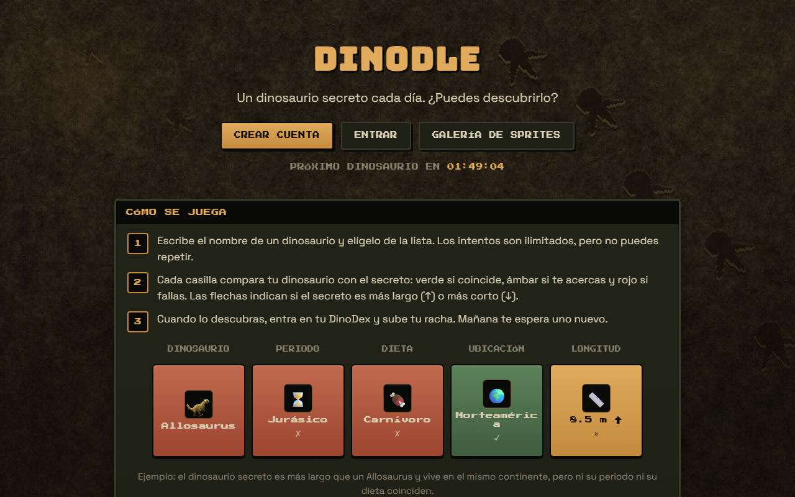
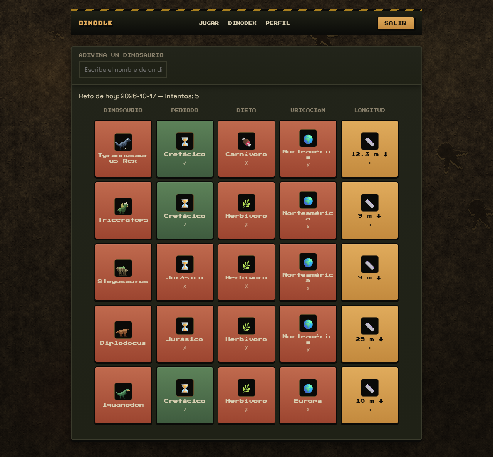
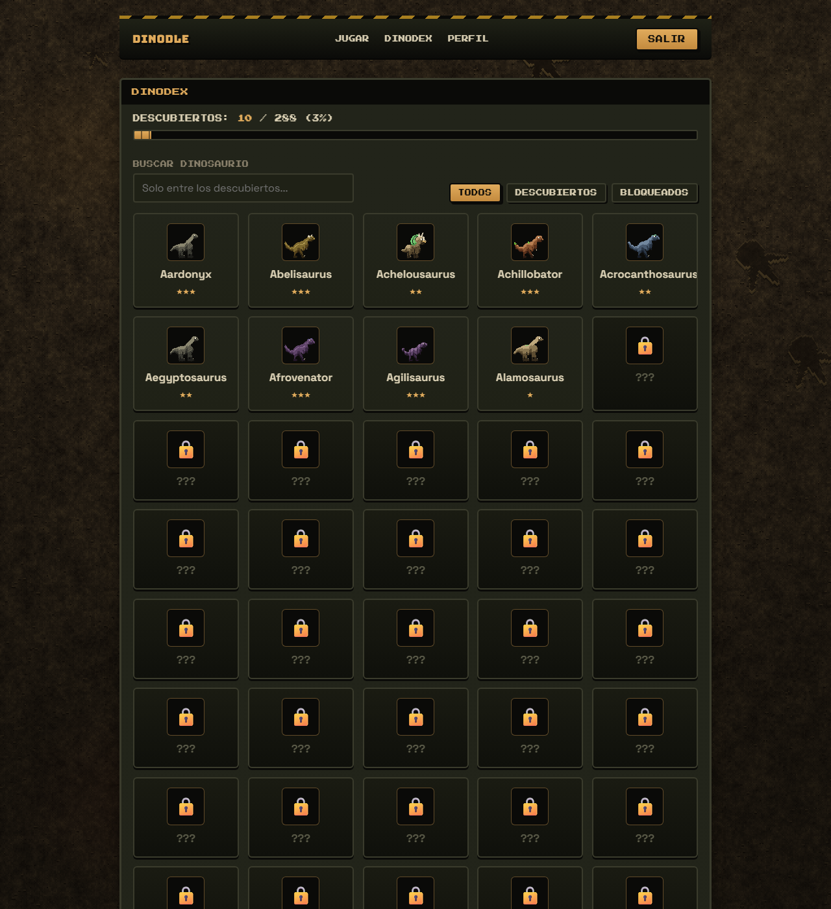

# Dinodle

Un dinosaurio secreto cada día. Escribe nombres, lee las pistas y descúbrelo antes de que se acabe el día. Cada acierto entra en tu DinoDex.

**En vivo:** https://dinodle.vercel.app

Proyecto personal de portfolio, hecho con React, TypeScript y Supabase.

## Capturas





## Cómo se juega

- Cada día hay un dinosaurio secreto. Cambia a las 00:00 UTC.
- Escribes el nombre de un dinosaurio y lo eliges de la lista. Los intentos son ilimitados, pero no se puede repetir.
- Cada intento enseña cinco casillas: dinosaurio, periodo, dieta, ubicación y longitud. Verde si coincide, ámbar si te acercas y rojo si fallas. Las flechas indican si el secreto es más largo o más corto.
- Al descubrirlo, el dinosaurio entra en tu DinoDex y sube tu racha.
- El perfil muestra tus estadísticas y un calendario de actividad.

## Stack

- React, TypeScript y Vite, con React Router.
- Supabase: PostgreSQL, Auth, Row Level Security y Edge Functions (Deno).
- CSS propio, sin frameworks. Fuentes Bungee, Press Start 2P y Space Grotesk.
- Vitest y Testing Library para los tests.

## Decisiones de diseño

**El dinosaurio del día nunca llega al navegador.** Las pistas se calculan en la Edge Function `submit-guess`, que consulta el dinosaurio secreto con permisos de servidor. El cliente solo recibe las pistas, y el nombre únicamente cuando ya has ganado.

**El cliente no puede escribir resultados.** Las tablas `games`, `guesses`, `streaks` y `user_dinosaurs` solo tienen política de lectura. Todo lo que cuenta (intentos, victorias, rachas, colección) lo escribe la Edge Function con la service role key.

**El reto diario se crea de forma perezosa.** `get-daily-challenge` crea el reto de hoy en la primera visita del día. La restricción `unique(date)` evita duplicados si dos personas entran a la vez, y excluye los dinosaurios de los últimos 30 días.

**El día es UTC**, tanto para el reto como para las rachas y el temporizador. En España el cambio ocurre a la 01:00 o las 02:00.

**El contador de intentos es atómico.** La función SQL `register_guess_attempt` hace un `UPDATE ... RETURNING`, así que dos peticiones simultáneas nunca obtienen el mismo número de intento. Solo acepta partidas del día actual y solo la puede ejecutar la service role.

**Las estadísticas se calculan, no se duplican.** La vista `user_stats` agrega desde `games` con `security_invoker`, de modo que cada usuario solo ve las suyas.

**Accesibilidad.** El buscador es un combobox con ARIA y navegación por teclado. Los resultados se distinguen por símbolo además de por color. Las animaciones respetan `prefers-reduced-motion`.

**Latencia.** Las funciones se invocan fijando la región de la base de datos (`FunctionRegion` en `src/services/gameService.ts`), para que función y base de datos estén en el mismo sitio.

## Datos

El catálogo tiene 288 dinosaurios: 12 curados a mano y 276 procedentes de un dataset público derivado de la Paleobiology Database (paleobiodb.org).

- Solo entran géneros con longitud, dieta, periodo y ubicación, porque son los datos que necesitan las pistas.
- Periodo: el más frecuente entre los registros fósiles del género, según el punto medio de su edad.
- Ubicación: los continentes que concentran al menos el 15% de los registros del género.
- Rareza: cuantos menos registros fósiles tiene un género, más raro es.
- Las descripciones de esos 276 se generan solo con campos del dataset (grupo y familia). Altura y peso no existen en el dataset y quedan vacíos.

## Sprites

Cada dinosaurio tiene un sprite de pixel art animado, dibujado de forma procedural por el estudio `scripts/sprite-studio/`. El estudio es determinista: el mismo slug produce siempre exactamente los mismos píxeles, así que las hojas se pueden regenerar en cualquier momento.

- **Galería pública** en `/sprites`, con ficha animada por dinosaurio en `/sprites/:slug`: visor con zoom, velocidad y fondos, descargas de hoja PNG y GIFs por animación.
- **Seis animaciones** por dinosaurio: idle, walk, attack, hurt, sleep y faint, en celdas de 64×64.
- **Salida**: `public/dinos/sprites/` (hojas `pixelart/<slug>.png`, GIFs `gifs/<slug>-<anim>.gif` y `manifest.json`) más el manifiesto tipado `src/data/sprites.ts`.
- **En el juego**: `DinoSprite` muestra el idle animado donde antes había emojis; si un dinosaurio no tuviera sprite, cae al emoji como respaldo.

```bash
npm run sprites          # genera los 288 dinosaurios (hojas, gifs y manifiesto)
npm run sprites:check    # verifica dimensiones, márgenes, gifs y determinismo
```

Para iterar sobre uno solo: `npm run sprites -- --solo <slug>` (con `--qc` para la hoja de revisión y `--vista` para la vista HTML). Los contactos de calidad quedan en `scripts/sprite-studio/_qc/`.

La estética está inspirada en [PMD Collab](https://sprites.pmdcollab.org/): sprites cuadrados mirando a la derecha, contorno oscuro de un píxel y animaciones cortas y legibles. Todo el arte de este proyecto es original y procede del propio estudio.

## Estructura

```
src/
  components/    game, layout, profile, sprites
  context/       sesión (AuthContext)
  data/          manifiesto de sprites generado
  lib/           cliente de Supabase
  pages/         Home, Login, Register, ForgotPassword, DinoDex, Dinosaur, Profile, Sprites
  services/      acceso a Supabase (los componentes no lo llaman directamente)
  types/
  utils/
scripts/
  generar-sprites.mjs  primera versión estática del set de sprites (obsoleta)
  sprite-studio/       estudio actual: cuerpos, animaciones, GIFs y verificación
supabase/
  schema.sql     tablas, políticas RLS, funciones y vista
  seed.sql       catálogo de dinosaurios
  functions/
    _shared/     lógica de pistas (con tests)
    get-daily-challenge/
    submit-guess/
public/          iconos y sprites generados (dinos/sprites/)
```

## Puesta en marcha

Necesitas Node.js (se desarrolló con Node 24) y una cuenta de Supabase.

1. Clona el repositorio e instala las dependencias:

   ```bash
   npm install
   ```

2. Crea un proyecto en Supabase. Copia la Project URL (Settings, Data API) y la clave pública (Settings, API Keys).

3. Copia `.env.example` a `.env.local` y rellena:

   ```
   VITE_SUPABASE_URL=
   VITE_SUPABASE_ANON_KEY=
   ```

4. En el SQL Editor de Supabase ejecuta `supabase/schema.sql` y después `supabase/seed.sql`.

5. Despliega las Edge Functions:

   ```bash
   npx supabase login
   npx supabase link --project-ref TU_PROJECT_REF
   npx supabase functions deploy get-daily-challenge
   npx supabase functions deploy submit-guess
   ```

   No las despliegues con `--no-verify-jwt`: `submit-guess` lee el id del usuario del token que Supabase ya ha verificado.

   Si tu proyecto no está en `eu-west-1`, cambia `FunctionRegion.EuWest1` en `src/services/gameService.ts` por la región de tu base de datos.

6. En Authentication, URL Configuration, añade `http://localhost:5173` como Site URL.

7. Arranca la aplicación:

   ```bash
   npm run dev
   ```

## Despliegue

La aplicación se publica como sitio estático (el cliente habla directamente con Supabase), así que vale cualquier hosting con soporte para SPA. En el repositorio va incluida la configuración de Vercel (`vercel.json`). La instancia pública está en https://dinodle.vercel.app.

1. Importa el repositorio en Vercel: el framework (Vite) se detecta solo y no hay que tocar los comandos de build.
2. Añade las variables de entorno `VITE_SUPABASE_URL` y `VITE_SUPABASE_ANON_KEY` con los mismos valores de tu `.env.local`.
3. Despliega. El *rewrite* de `vercel.json` manda las rutas del cliente (`/sprites/...`, `/dinodex`, etc.) a `index.html` para que los enlaces profundos funcionen, y los sprites van incluidos en el repositorio, así que no hay que regenerarlos en el build.
4. En Supabase, Authentication → URL Configuration, pon la URL del despliegue como Site URL y añade `https://tu-dominio/reset-password` a las Redirect URLs, para que los correos de confirmación y recuperación vuelvan a la web.

En otro hosting, replica el *rewrite* a `index.html` y sirve `dist/` como estático.

## Seguridad

La auditoría de seguridad de octubre de 2026 revisó secretos, accesos, dependencias, formularios y cabeceras. Lo que aplica a este proyecto:

- **Contraseñas**: las gestiona Supabase Auth (bcrypt con sal y sus propios límites de intentos). La aplicación nunca almacena contraseñas y este repositorio no contiene ninguna. La confirmación por email está desactivada para que cualquiera pueda crear una cuenta y jugar al instante; se puede reactivar en Authentication → Providers → Email.
- **Base de datos**: RLS activo en todas las tablas. El navegador solo puede leer (cada usuario lo suyo): ninguna tabla acepta escrituras del cliente, y las funciones `security definer` van con `search_path` vacío. Los permisos están endurecidos: `anon` y `authenticated` solo tienen `select` (más el `update` del perfil propio).
- **Edge Functions**: `submit-guess` exige un JWT válido (lo verifica la plataforma), valida que las entradas sean UUID y limita la fuerza bruta a 30 conjeturas por minuto y partida. `get-daily-challenge` es pública a propósito y no revela el dinosaurio objetivo.
- **Claves**: al cliente solo va la clave pública (`VITE_SUPABASE_ANON_KEY`, protegida por RLS); la service role key vive únicamente en las Edge Functions (entorno de Supabase). `.env.local` está ignorado por git: no hay secretos en el repositorio ni en su historial.
- **Cabeceras**: `vercel.json` añade CSP, `X-Content-Type-Options`, `X-Frame-Options`, `Referrer-Policy` y `Permissions-Policy` al despliegue (verificadas contra el build real).
- **Formularios**: validación de longitud en todos los campos (email ≤ 254, usuario ≤ 30, contraseña 6–128) y ningún HTML crudo en las vistas (React escapa por defecto; no se usa `dangerouslySetInnerHTML`).

El modelo de confianza completo, las comprobaciones con la clave pública y los
límites conocidos están en **[docs/caso-seguridad.md](docs/caso-seguridad.md)**.

## Tests

```bash
npm run test
```

Cubren la lógica de pistas, las fechas del calendario, el temporizador, el encoder GIF, la galería de sprites y los componentes principales (buscador, DinoDex, Home y Dinosaur).

## Limitaciones conocidas

- La tabla `dinosaurs` es de lectura pública, porque el buscador necesita todos los nombres. El DinoDex bloquea en la interfaz, no en la base de datos.
- Los sprites son procedurales: el estudio los genera a partir del catálogo y `DinoSprite` cae al emoji si faltara alguno. Los campos `image_url` y `sprite_url` siguen reservados para material dibujado a mano.
- Si cambia el día a mitad de una partida, hay que recargar la página.

## Siguientes pasos

- Retoques manuales de sprites: el estudio permite sobrescribir el cuerpo de un dinosaurio concreto sin tocar el resto.
- Filtros por periodo y dieta en el DinoDex.
- Panel de administración para gestionar el catálogo.
- Inicio de sesión con Google y GitHub.
