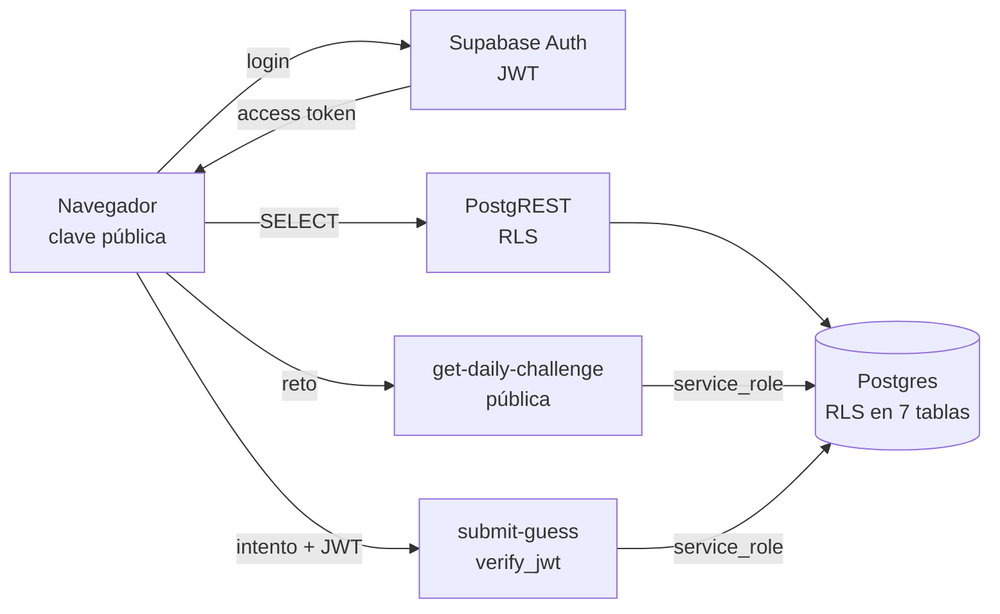

# Caso de estudio: seguridad de un juego diario con Supabase

**Dinodle** es un juego diario: hay un dinosaurio secreto y cada jugador escribe
nombres para descubrirlo con pistas. Tiene cuentas, rachas, un DinoDex personal
y un reto nuevo cada día. El catálogo y los sprites son públicos; el dinosaurio
del día, no.

- **En vivo:** https://dinodle.vercel.app
- **Código:** https://github.com/AlejandroPD05/dinodle
- **Stack:** React 19, TypeScript, Vite, Supabase (Postgres, Auth, RLS y Edge
  Functions en Deno) y Vercel.


## El modelo de amenazas

En un juego con cuentas y un secreto diario, los ataques interesantes no son
“romper el login”, sino estos:

1. **Ver el dinosaurio del día** sin jugar.
2. **Escribir directamente** partidas, intentos, rachas o dinosaurios en el
   DinoDex.
3. **Hacerse pasar por otro jugador** y usar su partida.
4. **Fuerza bruta**: probar todos los nombres hasta acertar.
5. **Inyección, XSS o clickjacking** a través de los formularios y la web.
6. **Escalar privilegios** llamando a funciones internas de la base de datos.
7. **Leer datos de otros jugadores.**

El punto de partida es incómodo: la clave pública de Supabase viaja al
navegador. No es un secreto, pero permite llamar a la API REST y a las Edge
Functions. Todo lo que se pueda hacer con ella tiene que estar controlado en el
servidor.

## El modelo de confianza

La regla es simple: **el navegador solo lee; todo lo que escribe pasa por una
Edge Function con `service_role`**, y cada función vuelve a comprobar de quién
es la partida.



Las decisiones que sostienen el modelo:

- **RLS activo en las 7 tablas** (`daily_challenges`, `dinosaurs`, `games`,
  `guesses`, `profiles`, `streaks` y `user_dinosaurs`), con 8 políticas.
- **Sin permisos de escritura para el cliente**: se revocan `insert`, `update`,
  `delete`, `truncate`, `references` y `trigger` a `anon` y `authenticated`. Solo
  queda `select` (y `update` del perfil propio).
- **La service role key no sale del servidor**: vive únicamente en el entorno de
  las Edge Functions.
- **Tres funciones `security definer` con `search_path` vacío** (`get_game_status`,
  `handle_new_user` y `register_guess_attempt`). `register_guess_attempt` y
  `handle_new_user` tienen `execute` revocado para `public`, `anon` y
  `authenticated`: solo las puede llamar `service_role`.

## El secreto del día

`daily_challenges` guarda la relación entre la fecha y el dinosaurio. La
política de lectura solo permite **retos pasados**:

```sql
create policy "daily_challenges_select_past"
  on public.daily_challenges
  as permissive for select to public
  using (date < current_date);
```

El reto de hoy no se puede leer por REST ni con la clave pública. La única
función que lo lee es `get-daily-challenge`, que usa `service_role` y devuelve
**solo `{ id, date }`**, nunca el `dinosaur_id`.

Cuando el jugador envía un intento, `submit-guess` compara el dinosaurio
elegido con el objetivo en el servidor, calcula las cinco pistas y **solo
devuelve el nombre del dinosaurio cuando el intento es correcto**. Antes de
ganar, el cliente no tiene forma de conocer la respuesta.

El reto se crea de forma perezosa la primera vez que alguien entra cada día:
se eligen candidatos que no hayan salido en los últimos 30 días y, si dos
peticiones llegan a la vez, la restricción `unique(date)` decide: la segunda
vuelve a leer la fila que creó la primera.

## Escribir sin poder hacer trampas

El flujo de un intento en `submit-guess`:

1. **La plataforma verifica el JWT** (`verify_jwt` activo). La función lee el
   `sub` del token ya verificado; no se fía de un id que mande el cliente.
2. Valida que los dos identificadores sean **UUID** con una expresión regular.
3. Carga el reto con `service_role`.
4. Busca la partida del usuario para ese reto o la crea. La partida se filtra
   por `user_id`: no se puede jugar en la partida de otro.
5. **Limita la fuerza bruta** a 30 intentos por minuto y partida: si se supera,
   responde `429` con `Retry-After`.
6. Rechaza un dinosaurio ya probado en esa partida.
7. Incrementa el número de intentos con `register_guess_attempt`, una función
   atómica que solo suma si la partida no está terminada y su fecha es la de
   hoy en UTC. Dos peticiones simultáneas no pueden saltarse el final de la
   partida.
8. Inserta el intento y, si es acierto, actualiza la partida, la racha y el
   DinoDex.

El cliente nunca decide si ha ganado: solo recibe pistas y un estado.

## Controles por amenaza

| Amenaza | Control | Dónde |
| --- | --- | --- |
| Ver el reto de hoy | RLS oculta los retos de hoy; la función pública solo devuelve `{id, date}` | `schema.sql`, `get-daily-challenge` |
| Escribir partidas, intentos o rachas | Sin `insert/update/delete` para el cliente; todo pasa por `service_role` | `schema.sql` (permisos) |
| Usar la partida de otro | El `user_id` sale del JWT verificado; la partida se busca por ese usuario | `submit-guess` |
| Repetir un dinosaurio | Comprobación en la función y numeración única por intento | `submit-guess`, `guesses_game_id_attempt_number_key` |
| Terminar la partida desde fuera | `register_guess_attempt` solo actúa si la partida no está cerrada y es de hoy | `register_guess_attempt` |
| Llamar a funciones internas | `execute` revocado para `public`, `anon` y `authenticated` | `schema.sql` |
| Escalar privilegios en funciones | `security definer` + `search_path = ''` | `schema.sql` |
| Inyección SQL | PostgREST y `supabase-js` parametrizan; los ids se validan como UUID | `submit-guess` |
| XSS | React escapa por defecto; no se usa `dangerouslySetInnerHTML`; longitudes máximas en los formularios; CSP sin scripts inline | `src/`, `vercel.json` |
| Clickjacking | `X-Frame-Options: DENY` y `frame-ancestors 'none'` | `vercel.json` |
| Fuga de datos del catálogo | `dinosaurs` es público a propósito (lo necesita el buscador); no contiene el secreto del día | `schema.sql` |

## Verificación con la clave pública

Estas son las comprobaciones hechas contra el proyecto real el **19/10/2026**,
usando solo la clave pública (la misma que lleva el navegador). No se escribió
ningún dato:

| Prueba | Resultado |
| --- | --- |
| `GET /rest/v1/daily_challenges?date=eq.hoy` | `200` y **0 filas** (RLS) |
| `GET /rest/v1/daily_challenges?date=lt.hoy` | `200` y 1 fila (los retos pasados sí se pueden leer) |
| `GET /rest/v1/dinosaurs` | `200` (catálogo público) |
| `POST /rest/v1/games` | `401` — `permission denied for table games` |
| `PATCH /rest/v1/profiles?id=eq.otro` | `401` — `permission denied for table profiles` |
| `POST /functions/v1/submit-guess` sin sesión | `401` — `No autenticado` |
| `POST /rest/v1/rpc/register_guess_attempt` | `401` — `permission denied for function register_guess_attempt` |

Además:

- **62 tests** en 13 ficheros (`npm test`).
- Cabeceras comprobadas contra el build real: CSP, `X-Frame-Options`,
  `X-Content-Type-Options`, `Referrer-Policy` y `Permissions-Policy`.
- El proyecto despliega en Vercel con `rewrites` a `index.html` y esas
  cabeceras en `vercel.json`, así que las rutas profundas (`/play`, `/dinodex`)
  también las reciben.

## Decisiones y límites (lo que un escáner no cuenta)

La seguridad no es un check list; estas son las decisiones conscientes y lo
que aún falta:

- **Intentos ilimitados**: es parte del producto (como en Wordle, pero sin
  límite de seis). El rate limit de 30/min frena scripts, pero **no hace
  imposible la fuerza bruta**: con 288 dinosaurios, un usuario decidido podría
  probarlos todos en unos 10 minutos. Si el juego tuviera ranking competitivo,
  habría que limitar intentos por partida o replantear el modo.
- **Confirmación por email desactivada**: se puede crear cuenta y jugar al
  instante. El trade-off es que no se demuestra la propiedad del correo; para
  un juego de portfolio se aceptó, y es reversible en
  Authentication → Providers → Email.
- **`getUserIdFromAuthHeader` decodifica el JWT sin verificar la firma**. Es
  deliberado: confía en que la plataforma ya lo ha verificado (`verify_jwt`).
  Por eso el despliegue **no puede usar `--no-verify-jwt`**; el README lo avisa.
- **CORS `*` en las Edge Functions**: es aceptable porque la identidad viaja en
  el header `Authorization` (no en cookies) y la plataforma verifica el JWT; no
  hay superficie de CSRF con credenciales ambientales.
- **Duplicados**: la regla de “no repetir dinosaurio” se valida en la función.
  La restricción única evita colisiones de numeración, pero un índice único
  `(game_id, dinosaur_id)` la llevaría también a la base de datos y cerraría
  una carrera teórica entre dos peticiones simultáneas.
- **El DinoDex bloquea la colección, no el catálogo**: los datos de todos los
  dinosaurios son públicos porque el buscador los necesita. Lo privado es qué
  ha descubierto cada usuario (`user_dinosaurs`), no la existencia del
  dinosaurio.
- **Contraseñas**: mínimo 6 caracteres, el mínimo de Supabase. Para un producto
  real subiría a 8-12 y añadiría MFA, que Supabase ya soporta pero aquí no se
  expone.

## Conclusiones

1. **RLS es el suelo, no el techo.** Con `service_role` en las funciones, cada
   escritura necesita su propia comprobación de propiedad.
2. **Denegar por defecto**: revocar escrituras y conceder lecturas una a una es
   más seguro que confiar en que el cliente no llame a un endpoint.
3. **El secreto se queda en el servidor** y se revela solo cuando se ha ganado.
4. **Un rate limit no es anti-cheat**: frena automatizaciones, pero no sustituye
   a un diseño de intentos limitados.
5. **Documentar los trade-offs** es parte del trabajo: la confirmación por email
   desactivada o el catálogo público son decisiones, no descuidos.

## Enlaces

- Esquema completo: [`supabase/schema.sql`](../supabase/schema.sql)
- Funciones: [`get-daily-challenge`](../supabase/functions/get-daily-challenge/index.ts)
  y [`submit-guess`](../supabase/functions/submit-guess/index.ts)
- Cabeceras: [`vercel.json`](../vercel.json)
- Commit de la auditoría: [`069c8a0`](https://github.com/AlejandroPD05/dinodle/commit/069c8a0)
- Tests: `npm test` (62 tests)
